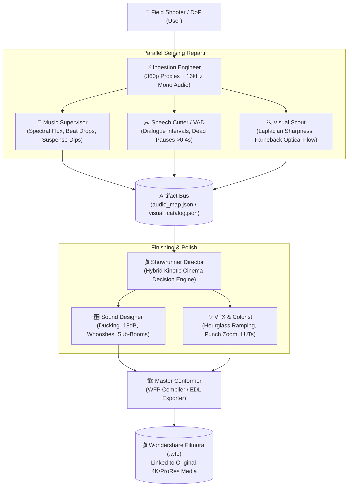

# AuraCineStudio - Architecture & Virtual Troupe Specifications

AuraCineStudio operates as an elite virtual post-production studio with strict separation of concerns, asynchronous event/artifact bus, and multi-core parallel sensing.

---

## The 5 Pillars of the Hybrid Signature

1. **In Media Res Hype-Hook**: 
   - Hyper-hook opening sequence (0.0s – 2.8s) with micro-cuts on maximum kinetic energy.
   - *The Dead Stop* vacuum (12 frames absolute silence before climax impact).
2. **Kinetic Optical Flow**:
   - Directional vector match-cutting on concordant axes (`PAN_RIGHT` $\rightarrow$ `PAN_RIGHT`).
   - Hourglass speed ramping curve (`180%` $\rightarrow$ `100%` $\rightarrow$ `220%`).
3. **Diegetic Foley Architecture**:
   - Hyper-immersive diegetic audio reinforcement.
   - Directional whooshes synchronized with camera whip pans.
   - Deep sub-bass impact booms on primary beat drops.
4. **Rhythmic Staccato Hyper-Cuts**:
   - Rapid micro-cuts on macro details (6–8 frames) locked to snare/transient spikes.
5. **Atmospheric Tonal Suspense**:
   - Tonal drone audio dilation with steep low-pass filtering (<300 Hz).
   - Asymmetric J-cuts and L-cuts on dialogue and emotional moments.

---

## Artifact Contracts Schema

| File Name | Producer | Consumer | Purpose |
| :--- | :--- | :--- | :--- |
| `audio_map.json` | `Music Supervisor` | `Showrunner` | Transients, BPM, drops, and suspense dips |
| `speech_map.json` | `Speech Cutter` | `Showrunner / Sound` | Dialog intervals, ducking trigger windows |
| `visual_catalog.json` | `Visual Scout` | `Showrunner` | Sharpness scores, motion vectors, spark triggers |
| `decision_blueprint.json` | `Showrunner` | `Sound & VFX Polish` | Timeline slots, source in/out points, speed curves |
| `polished_timeline.json` | `Sound & VFX` | `Master Conformer` | SFX track, ducking schedule, punch zooms |
